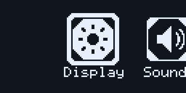
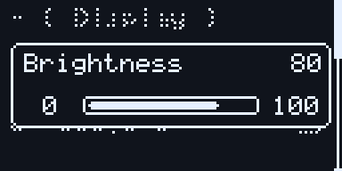
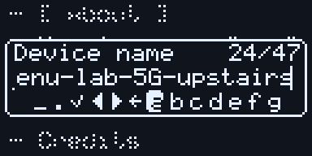

# tinymenu

[](https://github.com/lsongdev/tinymenu/actions/workflows/ci.yml)

A smooth, animated menu UI for small monochrome displays, written in plain C.
It draws into a 1-bit framebuffer you own and hands the rows that changed to a
callback, so it depends on no display library: an SSD1306, an ST7735 or
anything else that can show a bitmap will do.

- Tile, grid, list, chart and wave pages; message, confirm, value, digit, text input, list and
  progress popups.
  Popups are pages too, so any page can open any popup and popups nest.
- Input is a message queue (`prev`, `next`, `up`, `down`, `left`, `right`,
  `click`, `return`); buttons, encoders or a serial console all just send
  messages. Two buttons with long presses are enough for every page.
- Animations advance by real elapsed time, so they take the same time at any
  frame rate. When nothing moves the UI stops drawing and flushing.
- Partial flush: only the 8-row pages that changed since the last frame are
  handed to the display, found without a second framebuffer.
- Screen size is set at run time. Several UIs can run side by side.

## Screenshots

| Screen | Preview |
|---|---|
| Home |  |
| Value popup |  |
| Text input |  |

## Quick start

```c
#include <tinymenu.h>

static uint8_t framebuffer[128 * 64 / 8];
static tm_ui ui;
static tm_list_page settings;

static tm_option options[] = {
    {.text = "Settings"},
    {.text = "Brightness", .kind = TM_OPTION_INT, .val = 80},
    {.text = "Sound", .kind = TM_OPTION_SWITCH, .val = 1},
    {.text = "Version", .kind = TM_OPTION_TEXT, .content = "0.1"},
};

// Send pages [first_page, end_page) of the framebuffer to the display.
static void flush(const tm_fb *fb, int16_t first_page, int16_t end_page, void *user) { /* ... */ }

void setup(void) {
    tm_ui_init(&ui, framebuffer, 128, 64, flush, NULL);
    tm_list_page_init(&settings, &ui, 4, options, TM_LIST_NORMAL, NULL); // first page = home
}

void loop(void) {
    if (button_pressed()) tm_ui_send(&ui, TM_MSG_DOWN);
    tm_ui_proc(&ui, elapsed_ms_since_last_call);
}
```

[`examples/basic/basic.ino`](examples/basic/basic.ino) is the same thing as a
complete Arduino sketch with an SSD1306, three buttons and a value popup.

### The framebuffer

Pixel (x, y) is bit `y % 8` of `buf[(y / 8) * w + x]`: rows are grouped in
8-row *pages*, the native layout of SSD1306/SH1106-class controllers, which
can take the bytes as they are. For colour panels, `tm_fb_expand16()` turns
rows into 16-bit pixels with the two colours you choose, optionally scaled up
by an integer factor.

### Options

What a list row shows after its text is set by the option's `kind`:

| kind | row end | on click |
|---|---|---|
| `TM_OPTION_PLAIN` | nothing | callback only |
| `TM_OPTION_INT` | `val` | callback only |
| `TM_OPTION_FIXED` | `val` with `decimals` decimal places | callback only |
| `TM_OPTION_TEXT` | `content` | callback only |
| `TM_OPTION_SWITCH` | check box | the list flips `val` |
| `TM_OPTION_CHECK` | check box | callback only (`val` set by the app) |

A list shows a one-character `mark` before each text; leave it 0 for the
kind's default (`- = % > @ #`). In a `TM_LIST_RADIO` list, clicking a row
checks its box and clears the others. Value, digit, confirm and list popups can
read their value from the option they were opened on and write it back.

### Keys: one axis or a d-pad

Send `TM_MSG_PREV`/`TM_MSG_NEXT` from two or three buttons and from encoders
(clockwise is next); send `TM_MSG_UP`/`DOWN`/`LEFT`/`RIGHT` from a d-pad.
Next goes forward in reading order and raises a value, and every page can be
used with prev, next, click and return alone. Directions go by the screen,
and a direction a page has no use for goes the way it would move a value:
right and up forward, left and down back.

| | prev / next | d-pad |
|---|---|---|
| list, list popup | previous / next row | up/down; right and left also next / previous |
| tile page, wave page | previous / next tile or wave | left/right; up and down also next / previous |
| value popup | lower / raise | up and right raise, down and left lower |
| digit popup | pick a digit; click, then change it | left/right pick, up/down change at once |
| confirm popup | scroll the text, then switch button | up/down scroll, left/right switch |
| text input | every key in turn, then the actions | move over the grid of keys, wrapping |
| message popup | scroll | up/down scroll |

`tm_msg_step()` (-1/+1 down a list) and `tm_msg_amount()` (-1/+1 for a value,
or along tiles and waves) read any of them in callbacks. Before prev/next existed, two-button
setups sent `down`/`up`; that still works for lists and tiles, but a value
popup now lowers on `down`, so send `next`/`prev` instead.

### Popups and long text

A choice list popup can open on the current value with
`tm_list_popup_select()`. Message and confirm popups wrap between words.

Text that does not fit is cut, and scrolls while it is selected: list rows,
icon names under tiles and grids, popup texts and wave labels alike, all at
the same speed. One setting, `ui.params.slide_mode`, picks how for the whole
UI: `TM_SLIDE_ONCE` (the default) scrolls to the end, pauses and returns to
the start, after which the UI goes idle; `TM_SLIDE_LOOP` scrolls round
continuously; `TM_SLIDE_OFF` shows the start only.

### Text input

`tm_text_input_popup` edits a printable ASCII string without allocating memory.
Supply two non-overlapping buffers of the same capacity, including the final NUL:

```c
static char name[33] = "tinymenu", draft[sizeof(name)];
static tm_text_input_popup input;

// After initializing ui and the menu page:
if (tm_text_input_popup_init(&input, &ui, "Name", name, draft, sizeof(name), NULL, NULL))
    tm_jump_to_page(&settings, &input);
```

It fills the screen but for a small margin, framed over the blurred page: the
title and length, the text, edited at its end, a grid of keys, and under it a
fixed row of actions, `Aa` (upper or lower case), `#+` (symbols), `Space`,
`Del` and `OK`. The grid takes as many columns as fit (ten at most); its rows
share the height, and when they do not all fit, as many as the screen allows
show and scroll with the selection between the fixed text and actions. Too
short for a row of keys and the actions together, the actions scroll with
the grid. Up, down,
left and right move over the keys, wrapping, and from the grid to the action
under it; next and previous go through every key in turn, so two buttons with
long presses are enough. Click types the selected key. Return cancels, asking
for a second return when there are unsaved changes.

Pass a charset to limit the keys, such as `"0123456789"` for a PIN: its
characters make one page, without `Aa` and `#+`, and `Space` only when it
has a space.

Each entry reloads the current value; only `OK` writes to `name`, and the
callback can read `input.result` to tell save from cancel. With unsaved changes
the title turns into `Back = discard` until another key is pressed. Set
`input.secret = true` to mask the draft with asterisks. Both buffers, title and
charset must outlive the popup. It fits screens from 64x31; the demo's
Network → SSID row opens it.

`tm_digit_popup` edits individual decimal digits and the sign; `tm_value_popup`
adjusts the whole number by a fixed step. The former `tm_spin_popup` API and
`DEFAULT_SPIN_WIN_*` settings are now `tm_digit_popup` and `DEFAULT_DIGIT_WIN_*`.
Digit selection uses `selected_digit`, `move_digit()`, `change_digit()` and
`toggle_editing()` (with the `tm_digit_popup_` prefix).

### Progress

`tm_progress_popup` shows work the application does: loading, saving, an
update. Open it and drive it from your own loop; it redraws without a key
press:

```c
static tm_progress_popup saving;
tm_progress_popup_init(&saving, &ui, "Saving", 0, false, NULL); // max 0: busy

tm_jump_to_page(ui.current_page, &saving);
tm_progress_popup_set_max(&saving, total); // once the length is known
tm_progress_popup_set(&saving, written);   // as work proceeds; the bar slides there
tm_progress_popup_close(&saving);          // result: TM_PROGRESS_DONE
```

While busy (`max <= 0`, or after `tm_progress_popup_set_busy()`) a segment
runs through the bar for work of unknown length; setting a value switches to
a filled bar with its percentage. With `cancellable`, return closes the popup
with `TM_PROGRESS_CANCELLED`, which the work should poll. The bar itself is
`tm_progress` (`core/tm_progress.h`), for drawing one inside another page; the
value popup draws its bar with it. The demo's About → Check for update shows
both modes.

### Style

Two presets give a complete look; start from one and change what you like:

```c
tm_ui_set_preset(&ui, TM_PRESET_DEFAULT); // what tm_ui_init gives: tm_default_params
tm_ui_set_preset(&ui, TM_PRESET_CLASSIC); // a plain menu: no motion, square, no dimming
ui.params.style.highlight = TM_HIGHLIGHT_CORNERS;
```

`ui.params.style` holds the look of one UI:

```c
ui.params.style = (tm_style){
    .animate = true,                          // false: jump into place, no fades
    .radius = 255,                            // 0: square corners (255 keeps each element's own)
    .highlight = TM_HIGHLIGHT_FILL,           // or _FRAME (an outline) or _CORNERS
    .highlight_width = TM_HIGHLIGHT_FULL_ROW, // or _FIT_TEXT
    .transition = TM_TRANSITION_CASCADE,      // or _FADE or _SLIDE
};
```

That is the default preset. `highlight` is how every menu marks its
selection, the same everywhere: list rows, list popups, buttons, tiles and
grid icons. `TM_HIGHLIGHT_FILL` inverts the box and what is in it, `_FRAME`
draws its outline and `_CORNERS` only its four corners. `TM_OPTION_SWITCH`
rows always show a switch (knob left when off, filled with the knob right when
on); `TM_OPTION_CHECK` rows always show a checkbox.

`TM_TRANSITION_SLIDE` changes full pages with a push: going deeper, the new
page comes in from the right while the old one leaves to the left with its
highlight; returning, or jumping to the home page or to a page you came
through, goes the other way. The incoming page arrives already laid out (its
own unfold is skipped) and needs no second buffer: the framebuffer's `ox`
origin draws each page shifted and clipped. The speed is
`ani_param[TM_ANI_SLIDE]`. Popups still drop in over the page, and without
`animate` pages switch at once.

`TM_TRANSITION_CASCADE` (the default) fades the old page out quickly, then brings a list in
row by row: the rows on screen slide in one after another from the top, from
the right going deeper and from the left coming back, and the highlight rides
in with its row. Other pages enter as they do with the fade. It uses the same
`TM_ANI_SLIDE` speed and the same easing as every other animation (rows start
half of it apart).

The classic preset is the whole row inverted, square, redrawn only when a key
is pressed. Without animation a key press costs one or two flushes (4–13 of the
eight 8-row pages at 128x64, against 18–52 flushes when animated) and nothing
is drawn or sent after that, which suits slow buses and busy MCUs. The demo has
the switches and both presets on its Settings page.

### Menus: list, icon list, tile, grid

A menu item (`tm_option`) has a `mark` (`@ # >`, or one from its kind), an
`icon` (a page-major bitmap like the framebuffer) and its `text`. How a page
shows its items decides which it uses:

| | each item | moves by |
|---|---|---|
| list (`tm_list_page`) | mark, text, value or box at the end | row |
| icon list (the same list with an icon size) | icon in place of the mark; the row is as tall as the icon | row |
| tile (`tm_tile_page`) | icon with its name under it (`tm_icon_item`) | item, sideways |
| grid (`tm_grid_page`) | the same icon item, in rows of three | item, and row up/down |

```c
static tm_option apps[] = {
    {.text = "Display", .icon = display_icon},
    {.text = "Sound", .icon = sound_icon},
};
tm_grid_page_init(&grid, &ui, COUNT(apps), apps, 0, cb);           // 0: three per row
tm_tile_page_init(&tiles, &ui, COUNT(apps), apps, cb);
tm_list_page_init(&list, &ui, COUNT(apps), apps, TM_LIST_NORMAL, cb);
tm_list_page_set_icon_size(&list, 30, 30);                          // 0, 0: back to marks
```

Every menu page (list, tile, grid, chart, list popup) starts with the same
fields (`tm_menu`: page, items, selection, `icon_w` x `icon_h`), and they all
work the same way:

```c
tm_option* opt = tm_menu_selected(page); // the selected option, NULL if page is not a menu
tm_menu_move(page, 1);                   // as next would: wraps if the page loops
tm_menu_select(page, 3);                 // straight to an item, scrolling to it
```

Each kind also has its own `_move` and `_select` (`tm_list_page_move`,
`tm_tile_page_select`, ...).

An application that wants more on a page, such as the selected name in large
type or a status bar, draws it from the page's draw callback. It runs after the
page draws itself and before the highlight, every frame the page is drawn: on
its own, under a popup and while it slides:

```c
static void status(const tm_page* page, tm_canvas* canvas) {
    tm_canvas_draw_str(canvas, 1, 0, Font_6_8, tm_menu_selected(page)->text);
}
tm_page_set_draw(&home, status);
```

The UI only draws when something moves; when what the callback shows changes
on its own (a reading), set `ui.is_motionless = false` to have it drawn.

A list popup (`tm_list_popup`) is a menu too: it starts the same way and takes
options. Its rows show the text, with the option's icon when the popup has an
icon size, or a mark only if the option sets one (its rows are choices, not
settings). A click writes the chosen text into the content of the row it was
opened from.

```c
static tm_option sleep_choices[] = {{.text = "Never"}, {.text = "30 s"}, {.text = "5 min"}};
tm_list_popup_init(&sleep, &ui, COUNT(sleep_choices), sleep_choices, true, NULL);
```

All of a page's icons have its icon size: 30x30 by default on tile and grid
pages (set `icon_w`/`icon_h` after init), none on a list until
`tm_list_page_set_icon_size`. An item without an icon shows its mark in the
icon's place. Tile and grid show every name (`TM_ICON_NAME_ALL`, the default),
the selected one only (`_SELECTED`; room stays under every icon, so nothing
moves) or none (`_NONE`), in `name_mode`. On the tile page the spacing widens
to fit the names; in the grid they are cut at the cell width. The selection
marks the icon, in `style.highlight` like every other menu.

In a grid, left/right (and prev/next) move one item, wrapping like the tile
page; up/down move a row. It uses fewer columns than asked for when they do
not fit (a column takes the icon's width + 8 px; `tm_grid_page_cols` says how
many).

`tm_menu_page` is one menu that can take any of these layouts and change it
while the program runs. It is a single page at a single address (a union of
the four), so the pages it opens still return to it and a home page stays the
home page; switching keeps the selection:

```c
static tm_menu_page home;
tm_menu_page_init(&home, &ui, COUNT(items), items, TM_MENU_TILE, home_cb);
tm_menu_page_set_layout(&home, TM_MENU_GRID); // or _ICON_LIST, _LIST, _TILE
```

The demo's home page is one: Settings → Home as switches it between tiles, a
grid and an icon list. Clock, Battery, Music, Mail and Lock are placeholder
entries so the grid has rows to scroll through. Settings and About are the
last two items in every layout.

### Charts and waves

Two pages show numbers. `tm_wave_page` is a live time series: push a sample
with `tm_wave_page_push` and it scrolls by, one pixel per sample, drawn
as a line (`TM_WAVE_SOLID`), dashes, a filled area or steps (`TM_WAVE_STEP`,
for a digital input). The axis follows the values on screen, or stays fixed
with `fixed_min`/`fixed_max` (0..1 for a GPIO, 0..100 for a percentage). A
page holds several waves and shows one (`tm_wave_page_move`/`_select`); a
click stops it (`tm_wave_page_stop`) and left/right then scroll back through
what it kept (`tm_wave_page_scroll`).

`tm_chart_page` shows a set of values: each item is an option, its `text` the
label and its `val` the value (with its `decimals`). It is a menu like the
others: the selection moves along it in the style's highlight, and a click can
open a value popup that edits the selected item.

```c
static tm_option week[] = {{.text = "Mon", .val = 32}, {.text = "Tue", .val = 45}, ...};
tm_chart_page_init(&chart, &ui, COUNT(week), week, TM_CHART_BAR, cb); // or _HBAR, _LINE
chart.min = 0; chart.max = 100; // both 0: from the values
```

`TM_CHART_BAR` draws columns (labels under them when they fit, otherwise the
selected one in the header), `_HBAR` a row per item with its label, bar and
value, scrolling like a list, and `_LINE` points joined by lines. Change values
whenever you like and call `tm_chart_page_refresh`; the demo's spectrum does
it every 50 ms. In the demo, Stats shows a week three ways and a spectrum. The
Sensor page simulates temperature, light, vibration and a digital signal on
every board, so no sensor wiring or callbacks are needed.

To use the shared demo, call `tm_demo_init(&ui)` after `tm_ui_init`, then call
`tm_demo_feed(now_ms)` about every 50 ms alongside the normal `tm_ui_proc` loop.
The Arduino examples use `tm_demo_tick(now_ms)` to advance both the demo data
and the UI.

### Screen sizes

The layout is computed from the screen size at run time and is checked by
snapshots at 96x64, 128x64, 128x128, 160x80 and 160x128.

| | needs |
|---|---|
| text input popup | 64x31; 128x32 shows one row of keys at a time, 128x64 two rows and the actions |
| list pages, list popup | any width, 32 px height |
| wave page | 96x64 |
| value, message, confirm, progress popups | 96x64 (the message popup scrolls at 32 px) |
| tile page | 96x48 with names and 30 px icons, 96x36 without names |
| digit popup | 96x64 with the default fonts |
| grid page | 96x48 with names and 30 px icons (two columns below 118 px wide) |
| icon list | any width, the icon height + 4 px |

Fonts, icon size and spacing are compile-time defaults in `src/tm_config.h`.
On panels much larger than 160x128 (320x240, say) the default fonts get small:
lay the UI out at half size and let `tm_fb_expand16(..., 2, ...)` double it.

## Layout

```
src/
  tinymenu.h        the only header applications include
  tm_config.h       compile-time defaults (fonts, spacing)
  core/             UI state machine, page base, input messages, animation, progress bar
  gfx/              framebuffer, drawing, text and fonts; knows nothing about the UI
  pages/            full-screen pages: tile, grid, list, chart, wave
  popups/           popups: message, confirm, value, digit, text input, list, progress
examples/
  basic/            minimal Arduino sketch (SSD1306, three buttons)
  demo/             the demo: a settings menu that uses every page and popup, shared by
                    the boards below and the host test
  matrixbit/        PlatformIO: YFROBOT Matrix:bit, SSD1306 128x64 over I2C
  xiaomiao/         PlatformIO: XiaoMiao handheld, ST7735 160x128 over SPI (LovyanGFX)
  m5stickc/         PlatformIO: original M5StickC, ST7735S 160x80
  folotoy/          PlatformIO: FoloToy AI Passport (ESP32-C3), ST7789P3 240x320
test/               host renderer, snapshots, unit checks, ESP-IDF build check
docs/design.md      how it works inside
```

## Using it

| Build system | How |
|---|---|
| Arduino IDE | install the repository as a library (`library.properties`), `#include <tinymenu.h>` |
| PlatformIO | `lib_deps = https://github.com/lsongdev/tinymenu.git` (`library.json`) |
| ESP-IDF | put the repository under `components/`, or add it to `idf_component.yml`, and `REQUIRES tinymenu` |
| CMake | `add_subdirectory(tinymenu)` and link the `tinymenu` target |

## Boards

```sh
pio run -d examples/matrixbit -t upload --upload-port <port>
```

| board | buttons | frame flush (full / typical partial) |
|---|---|---|
| Matrix:bit | A: next, long A: previous; B: click, long B: back | 10.6 ms / 4–9 ms (I2C at 1 MHz) |
| XiaoMiao | D-pad moves, A: click, B: back | 8.7 ms / 1.5–5 ms (SPI at 40 MHz, DMA) |
| M5StickC | B: next, long B: previous; A: click, long A or power: back | 9.8 ms / 2.5–8 ms |
| [FoloToy AI Passport](examples/folotoy) | Up/down: previous/next (hold to repeat); OK: click, long OK: back | not measured (SPI at 40 MHz, 2x scaling) |

All demos use [tinybutton](https://github.com/lsongdev/tinybutton) for button
debouncing, long presses and repeat. PlatformIO installs a pinned revision.
`tm_demo_arduino.h` handles digital buttons; the FoloToy example reads its
ADC ladder in `examples/folotoy/src/main.cpp`.

All accept input over serial (115200): `u` `d` `l` `r` are the d-pad,
`.` and `,` next and previous, `e` clicks, `b` goes back, `p` prints frame timing and `s` dumps the framebuffer
as hex.

## Tests

```sh
make -C test          # unit checks, then render every size and compare with test/snapshots/
make -C test update   # accept intentional visual changes
```

The renderer runs a scripted session of the demo under AddressSanitizer and
UndefinedBehaviorSanitizer. Its flush callback copies only the pages it is
given into a simulated display, and every snapshot is taken from that display
after checking it against the framebuffer, so a missed partial update fails
the test. Screens land in `test/out/<w>x<h>/` with a `sheet.png` overview.

CI runs the host test under gcc and clang and builds the PlatformIO examples,
the ESP-IDF component and the Arduino sketch.

## License

tinymenu is licensed under the GNU Affero General Public License, version 3
(`AGPL-3.0-only`). See [LICENSE](LICENSE) for the full terms.

This project is a refactor of [WouoUI-PageVersion](https://github.com/Sheep118/WouoUI-PageVersion)
by Sheep118 and contributors, itself based on the design of
[WouoUI](https://github.com/RQNG/WouoUI) by RQNG.

Code derived from WouoUI-PageVersion retains its upstream MPL-2.0 license
notices. A copy of that license is included in [LICENSES/MPL-2.0.txt](LICENSES/MPL-2.0.txt).
